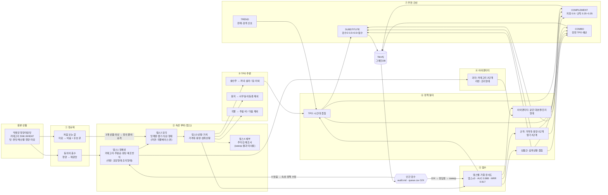
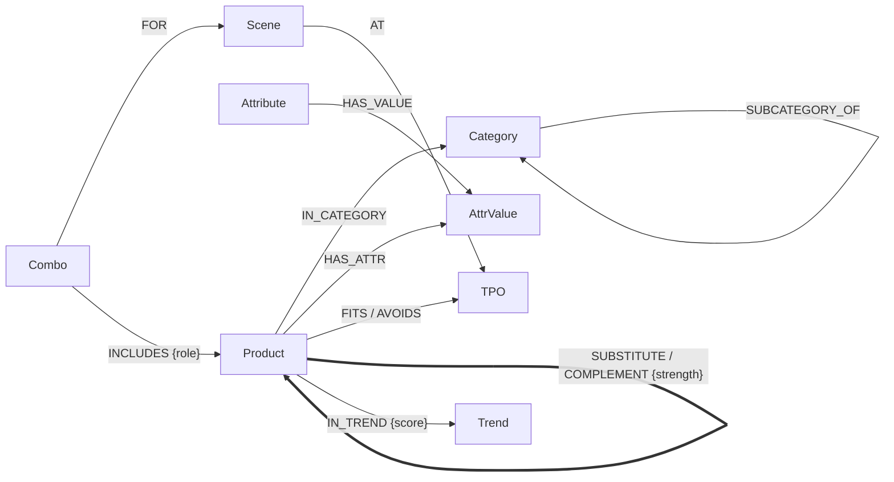

# cvs-taxonomy

우리동네GS 추천(대체재·보완재·트렌드·콤보)용 온톨로지 그래프DB.
텍소노미 → TPO 추론 → 정책(상품간·규격·속성·아이덴티티)으로 튀는 추천 차단 → 인간 검수 루프 → Neo4j 적재.
설계 문서: `docs/design.md` / `docs/design.pdf`, 속성 증강 흐름도: `docs/attribute_augmentation.mmd`
1차 범위는 **과자 43개 + 라면 18개**(시드). 다음 순서는 생필품 → 음료(보완재 본격 확장).

## 속성 증강 플로우



FigJam 스타일 보드(상품 예시·정책 차단 포함): [`docs/board.html`](docs/board.html) — 내려받아 브라우저로 열면 됩니다.

## 그래프 스키마




## 구성

| 경로 | 내용 |
|---|---|
| `taxonomy/categories.yaml` | 카테고리 트리 34노드 (과자 5대분류 · 라면 국물/국물없음). 노드마다 정의 |
| `taxonomy/schema.yaml` | 속성 17개 · 뎁스 1~4 · 값마다 정의 · 동의어 |
| `data/products.csv` | 시드 상품 61개. 다중값은 `\|` 로 구분 |
| `docs/ramen_vs_snack.md` | 과자 vs 라면 공통점·차이점과 설계 반영 내용 |
| `docs/unknown_attribute_policy.md` | 새 상품에 없는 속성이 들어왔을 때 대응방침 |
| `review/gold.csv` | 검수 정답셋 (대체 가능 O=1 / X=0) |
| `review/queue.csv` | 검수 대기 후보 |
| `config/weights.yaml` | sweep 결과(쓰는 뎁스·뎁스별 가중치 배수) |
| `ontology/policy.yaml` | 정책: 아이덴티티·대체재·규격·보완재·콤보·트렌드 |
| `ontology/tpo.yaml` | TPO 차원·속성→TPO 추론 규칙·콤보 장면 6개 |
| `data/trends.csv` | 트렌드 신호(판매·검색). 현재 비어 있음 |
| `out/audit.md` | 검수용 리포트: 정책 충돌·장면별 콤보·대체재·정책이 막은 추천 |

## 속성 뎁스

| 뎁스 | 의미 | 속성 |
|---|---|---|
| 1 정체성 | 무엇인가 | 카테고리, 주원료, 유탕여부, 제조방식 / (라면) 포장형태, 조리형태 |
| 2 감각 | 어떤 맛·식감인가 | 맛계열, 맵기, 식감, 형태 / (라면) 국물베이스, 면 |
| 3 상황·가치 | 언제·얼마에 | 가격대, 용량, 섭취상황 |
| 4 세부 | 누가 | 주타깃, 제조사 |

뎁스는 고정값이 아니라 `sweep` 이 정한다. 뎁스 1~4 각각 뎁스별 가중치 배수를 그리드로 돌려
검수 정답셋 기준 **AUC**(대체 O 쌍이 X 쌍보다 높게 나오는 비율)와 **MRR**(대체 O 후보가 전체 중 몇 등인지)을 재고,
성능이 거의 같으면(0.01 이내) 더 얕은 뎁스를 고른다. 현재 시드 기준 결과:

```
뎁스≤1  AUC 0.957  MRR 0.888  종합 0.923
뎁스≤2  AUC 0.980  MRR 0.902  종합 0.941
뎁스≤3  AUC 0.988  MRR 0.917  종합 0.952   ← 선택 (뎁스2·3 배수 0.5)
뎁스≤4  AUC 0.990  MRR 0.902  종합 0.946   (제조사·타깃을 넣으면 순위가 오히려 나빠짐)
```

## 점수와 간선 강도

- **대체재 점수**: 같은 type 안에서 속성별 유사도(트리 거리 / 일치 / 자카드 / 순서 거리)의 가중 평균. 결측 처리는 대응방침 문서 참고.
- **SUBSTITUTE 강도**: 검수 O → `0.5 + 0.5×점수` (바닥 0.5) · 검수 X → 간선 없음 · 미검수 → `0.8×점수` (상품당 상위 5개, 점수 0.55 이상)
- **COMPLEMENT 강도**: 직접 지정 조합(예: 짜파게티+너구리 0.9) > 속성 규칙(0.25~0.35, 가설이라 낮게)
- **정책 필터**: 점수와 별개인 하드 조건. 위반하면 간선을 만들지 않고 audit.md 에 사유를 남긴다. 검수 O인데 위반이면 '정책 충돌'.

## 루프

```
python cvs.py validate        # 1. 정의 누락·처음 보는 값 점검 → review/new_values.csv
python cvs.py sweep           # 2. 뎁스·가중치 튜닝 → config/weights.yaml
python cvs.py review export   # 3. 검수 후보 → review/queue.csv
#    queue.csv 의 verdict 칸에 O(대체 가능) / X(아님) 입력
python cvs.py review import   # 4. 검수 결과 → gold.csv
python cvs.py sweep           # 5. 늘어난 정답셋으로 다시 튜닝 (2~5 반복)
python cvs.py graph           # 6. out/graph.cypher, out/edges.csv
```

검수에서 X가 많이 나오면 = 스키마가 그 차이를 못 잡는다는 뜻이다. 그 쌍을 보고 속성/값을 추가하거나 정의를 고친 뒤 루프를 다시 돈다.

## Neo4j 적재

```
docker compose up -d
pip install neo4j
NEO4J_PASSWORD=cvs-taxonomy python cvs.py graph --push
```

Docker 없이 쓰려면 Neo4j Browser/AuraDB에 `out/graph.cypher` 를 실행한다. 재실행해도 노드는 MERGE, 추천 간선은 지우고 다시 만든다.

그래프 모델:

```
(:Product)-[:IN_CATEGORY]->(:Category)-[:SUBCATEGORY_OF]->(:Category)
(:Product)-[:HAS_ATTR]->(:AttrValue)<-[:HAS_VALUE]-(:Attribute)
(:Product)-[:SUBSTITUTE {strength, model_score, review, depth}]->(:Product)
(:Product)-[:COMPLEMENT {strength, reason, source}]->(:Product)
(:Product)-[:FITS|AVOIDS]->(:TPO)<-[:AT]-(:Scene)<-[:FOR]-(:Combo)-[:INCLUDES {role}]->(:Product)
(:Product)-[:IN_TREND {score, source}]->(:Trend {period})
```

예: 신라면 대체재 → `MATCH (:Product {name:'신라면'})-[r:SUBSTITUTE]-(p) RETURN p.name, r.strength ORDER BY r.strength DESC`

## 주의

- 시드 상품 속성값·가격대는 일반 지식 기반 **초안**이다. 검수 정답셋(`gold.csv` source=seed)도 초안이라 사람 검수로 바꿔 가야 한다.
