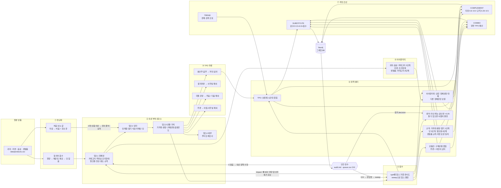
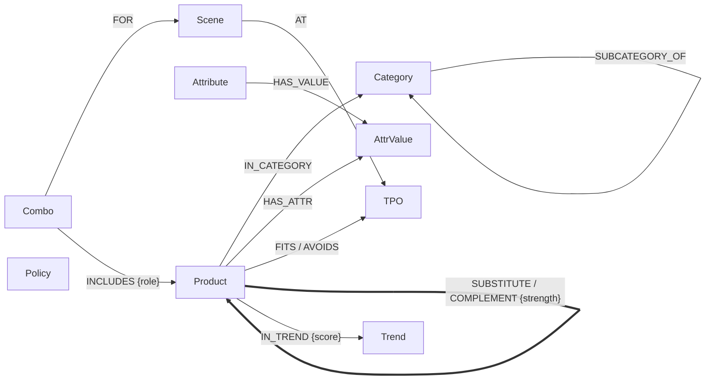

# cvs-taxonomy

우리동네GS 추천(대체재 · 보완재 · 트렌드 · 콤보)을 위한 온톨로지 그래프DB.
과자 → 라면 → 생필품 → 음료 순서로 같은 루프를 반복해 텍소노미·속성·정책을 정의하고, 추천 간선과 강도를 Neo4j에 적재한다.
핵심은 **TPO와 상품간·규격·속성·아이덴티티 정책으로 튀는 추천을 막는 것**이다.


> 보드는 실제 파이프라인 결과로 생성된다. 데이터·정책을 바꾸면 `python tools/board_svg.py` 로 다시 그린다.

## 범위

| type | 시드 상품 | 정답셋(O/X) | 선택 뎁스 | AUC | MRR | 대체 간선 | 정책 차단 |
|---|---|---|---|---|---|---|---|
| 과자 | 43 | 136 | ≤3 | 0.793 | 0.890 | 68 | 15 |
| 라면 | 22 | 56 | ≤2 | 0.930 | 0.884 | 24 | 25 |
| 음료 | 27 | 25 | ≤2 | 1.000 | 1.000 | 13 | 56 |
| 생필품 | 17 | 9 | ≤1 | 0.833 | 0.706 | 2 | 13 |

보완 간선 674 (과자↔라면 217 · 라면↔음료 210 · 과자↔음료 184 · 생필품↔생필품 56 …) · 콤보 34 (장면 7개) · 트렌드는 데이터 대기.
정답셋 226쌍 = 시드 78 + AI 1차 검수 147 + 사람 검수 1. Neo4j 5.26 로컬 적재 검증 완료(노드 461 · 관계 3,428).

## 속성 증강 플로우



## 그래프 스키마



## 텍소노미와 속성 뎁스

카테고리 71노드, 속성 27개(점수용 25 + 앵커 정책 전용 2). 모든 카테고리·속성·값에 정의가 있다(`validate` 가 빠진 정의를 실패 처리).

| 뎁스 | 의미 | 공통 | 과자 | 라면 | 음료 | 생필품 |
|---|---|---|---|---|---|---|
| 1 정체성 | 무엇인가 | 카테고리 | 주원료·유탕·제조방식 | 유탕·포장형태·조리형태 | 주원료·알코올·탄산 | 용도·규격 |
| 2 감각 | 어떤 맛인가 | 맛계열 | 맵기·식감·형태 | 맵기·국물베이스·면 | 카페인·당 | — |
| 3 상황·가치 | 언제·얼마에 | 가격대·용량·구매상황 | | | 음용온도·용기 | |
| 4 세부 | 누가 | 주타깃·제조사 | | | | |

뎁스는 type별로 sweep이 정한다. 뎁스 1~4마다 뎁스별 가중치 배수(0.25/0.5/1/2)를 전부 돌려,
정책까지 적용한 최종 추천을 정답셋 기준 AUC·MRR로 재고 성능이 거의 같으면(0.01 이내) 얕은 뎁스를 고른다.
처음 시드 정답셋(9~33쌍)에서는 과자가 제조사 배수 2로 과적합됐다. 검수 루프 4회로 정답셋을 늘리자 과자는 ≤3으로 내려왔고 제조사는 점수에서 빠졌다.

### 속성 영향도 — 늘린 속성이 추천에 실제로 쓰이는가

`python cvs.py impact` 가 속성을 하나씩 빼 보고(가중치 0) 성능 변화와 상위 5 추천 변동률을 잰다.
정책·TPO가 쓰는 속성은 점수 영향과 무관하게 유지하고, 나머지는 기준에 따라 유지·보류·제거를 정한다 → [`docs/attribute_impact.md`](docs/attribute_impact.md).

| 판정 | 속성 |
|---|---|
| 제거 권장 (빼면 성능 상승) | 과자 제조방식, 라면 국물베이스 |
| 제거 후보 (영향 미미·미사용) | 과자·라면 유탕여부, 라면 면, 음료 카페인·용기, 전 type 제조사 |
| 기여 큰 속성 | 과자 맛계열·주원료·식감, 라면 맵기·카테고리, 음료 카테고리·당 |

## 정책 (튀는 추천 방지)

`ontology/policy.yaml`. 점수와 별개인 하드 조건이다. 위반하면 간선을 만들지 않고 `out/audit.md` 에 사유를 남긴다.

| 정책 | 내용 | 막은 예 |
|---|---|---|
| 아이덴티티 | 같은 정체성끼리만 대체, 다른 정체성끼리만 보완 | 짜파게티 → 비빔면 (조리형태 다름) |
| 상품간 | 대체재는 구매상황이 겹쳐야 함 | 하리보 → 자일리톨 껌 (간식 vs 입가심) |
| 규격 | 가격대·용량·맵기 1단계, 당 2단계, 알코올 0단계, 생필품 규격 일치, 라면 포장형태 일치 | 코카콜라 → 코카콜라 제로, AA → AAA, 맥주 → 소주 |
| 제한 상품 | 주류 × 어린이 상품 보완·콤보 금지 | — |
| TPO | 보완재는 시간대가 겹쳐야 함 | 해장 라면 + 게토레이 |

### 대체 기준(앵커) — 브랜드냐 메뉴냐

불닭볶음면을 찾는 손님에게는 같은 라인(까르보불닭)을, 다른 손님에게는 같은 메뉴를 권해야 할 수 있다.
상품마다 앵커를 `line`(브랜드 라인) / `menu`(대표 메뉴) / `category` 중 하나로 정한다 → [`docs/anchor_policy.md`](docs/anchor_policy.md).

| 조건 | 앵커 |
|---|---|
| 라인·메뉴가 둘 다 이름에 있음 (오모리 김치찌개, 까르보불닭) | **사람이 정함** (`review/anchor.csv` decision 칸) |
| 같은 라인 후보가 있음 (불닭볶음면) | line |
| 같은 메뉴 후보가 있음 (진짬뽕) | menu |
| 그 외 | category (속성 유사도만) |

앵커가 같으면 유사도 +0.25, 상위 k 밖이어도 후보에 넣는다. 하드 정책은 못 뚫는다(코카콜라 → 제로는 여전히 금지).

검수에서 O를 받았는데 정책에 걸리면 '정책 충돌'로 따로 보고한다. 현재 1건(2080 칫솔 ↔ 여행용 칫솔세트) — 정책과 검수 중 어느 쪽이 맞는지 사람이 정한다.

## TPO와 콤보

상품마다 TPO를 찍지 않고 속성에서 추론한다(`ontology/tpo.yaml`). 새 상품도 속성만 채우면 TPO가 따라온다.

- 시간대: 아침 · 점심 · 오후 · 저녁 · 심야 / 장소: 집 · 사무실·학교 · 야외·캠핑 · 이동중 / 날씨: 더움 · 추움 · 비
- 예: 봉지라면 → 사무실 제외, 국물·온장 커피 → 더움 제외, 주류 → 아침·사무실·이동중 제외, 우산 → 비

콤보 장면 7개: 심야 혼술·야식, 사무실 점심 컵라면, 오후 사무실 나눔 간식, 캠핑 저녁, 더운 날 점심, 비 오는 날 퇴근길, 갑작스런 외박.
장면 TPO에 맞고, 정체성이 겹치지 않고, 제한 정책을 지키고, 예산 안인 조합만 남긴다.

## 간선 강도

| 관계 | 강도 |
|---|---|
| 대체 — 검수 O | 0.5 + 0.5 × 유사도 (바닥 0.5) |
| 대체 — 검수 X | 간선 없음 |
| 대체 — 미검수 | 0.8 × 유사도 (상품당 상위 5, 유사도 0.55 이상) |
| 보완 — 지정 조합 | 사람이 정한 값 (짜파구리 0.9, 칫솔+치약 0.9, 불닭+우유 0.7 …) |
| 보완 — 속성 규칙 | 0.25 ~ 0.5 (안주+맥주 0.5, 매운 라면+우유 0.45 …) |
| 콤보 궁합 | 상품쌍 보완 강도 평균, 없으면 시간대 겹침 × 0.3 |

## 루프

```
python cvs.py validate        # 1. 정의 누락·처음 보는 값 점검 → review/new_values.csv
python cvs.py sweep           # 2. type별 뎁스·가중치 튜닝 → config/weights.yaml
python cvs.py review export   # 3. 검수 후보 → review/queue.csv (정책 차단 쌍은 제외)
#    queue.csv 의 verdict 칸에 O(대체 가능) / X(아님) 입력
python cvs.py review import   # 4. 검수 결과 → review/gold.csv (AI 1차 검수는 --source claude)
python cvs.py sweep           # 5. 늘어난 정답셋으로 다시 튜닝 (2~5 반복)
python cvs.py anchor          #    대체 기준 판정 → review/anchor.csv (pending 은 사람이 decision 칸에)
python cvs.py impact          #    속성 영향도 → out/attribute_impact.csv
python cvs.py graph           # 6. out/graph.cypher · out/edges.csv · out/audit.md
python tools/board_svg.py     # 7. README 보드 갱신
```

X가 많이 나오면 스키마나 정책이 그 차이를 못 잡는다는 뜻이다. 그 쌍을 보고 속성·정의·정책을 고친 뒤 루프를 다시 돈다.
새 카테고리를 넣는 절차와 생필품·음료 대응방침은 [`docs/new_category_policy.md`](docs/new_category_policy.md), 처음 보는 속성 대응은 [`docs/unknown_attribute_policy.md`](docs/unknown_attribute_policy.md).

## Neo4j 적재

```
docker compose up -d
pip install neo4j
NEO4J_PASSWORD=cvs-taxonomy python cvs.py graph --push
```

Docker 없이 쓰려면 Neo4j Browser/AuraDB에 `out/graph.cypher` 를 실행한다. 재실행하면 노드는 MERGE, 추천 간선·콤보는 지우고 다시 만든다.

포터블 JDK 21 + Neo4j Community 5.26 으로 로컬 적재를 검증했다(적재 약 30초).

```cypher
// 불닭볶음면 큰컵 대체재 (anchor = line)
MATCH (:Product {name:'불닭볶음면 큰컵'})-[r:SUBSTITUTE]-(p) RETURN p.name, r.strength, r.anchor
// 신라면 대체재
MATCH (:Product {name:'신라면'})-[r:SUBSTITUTE]-(p) RETURN p.name, r.strength ORDER BY r.strength DESC
// 카스와 같이 살 것
MATCH (:Product {name:'카스 프레시 500ml 캔'})-[r:COMPLEMENT]-(p) RETURN p.name, r.strength, r.reason ORDER BY r.strength DESC
// 비 오는 날 퇴근길 콤보
MATCH (c:Combo)-[:FOR]->(:Scene {id:'rainy_commute'}), (c)-[i:INCLUDES]->(p) RETURN c.rank, i.role, p.name ORDER BY c.rank
```

## 파일

| 경로 | 내용 |
|---|---|
| `taxonomy/categories.yaml` | 카테고리 트리 (과자·라면·음료·생필품), 노드마다 정의 |
| `taxonomy/schema.yaml` | 속성 27개 · 뎁스 · 값마다 정의 · 동의어 |
| `ontology/policy.yaml` | 아이덴티티 · 대체재 · 규격 · 보완재 · 제한 상품 · 콤보 · 트렌드 · 앵커 · 속성 영향도 기준 |
| `ontology/tpo.yaml` | TPO 차원 · 속성→TPO 추론 규칙 · 콤보 장면 7개 |
| `data/products.csv` | 시드 상품 109개. 다중값은 `\|` 로 구분 |
| `data/trends.csv` | 트렌드 신호(판매·검색). 현재 비어 있음 |
| `review/gold.csv` · `review/queue.csv` | 검수 정답셋(source: seed · claude · review) · 검수 대기 |
| `review/anchor.csv` | 상품별 대체 기준 판정 · 사람 결정 칸 |
| `out/edges.csv` · `out/graph.cypher` | 추천 간선(강도·검수 상태·앵커) · Neo4j 적재 스크립트 |
| `out/products_enriched.csv` | 속성 증강 결과 (정규화 속성 + 추론 TPO + 아이덴티티) |
| `out/combos.csv` · `out/blocked.csv` · `out/audit.md` | 콤보 · 정책 차단/충돌 목록 · 검수용 리포트 |
| `out/attribute_impact.csv` | 속성 영향도 판정 |
| `config/weights.yaml` | sweep 결과 (type별 뎁스·배수) |
| `docs/design.md` · `docs/design.pdf` | 설계 문서 |
| `docs/board.svg` | 위 보드 |

## 주의

- 시드 상품의 속성값·가격대와 정답셋은 일반 지식 기반 초안이다. 정답셋 중 147쌍은 AI 1차 검수(`source=claude`)라 사람 검수로 바꿔 가야 한다.
- 트렌드는 판매·검색 데이터가 없어 비워 두었다. 근거 없는 점수를 만들지 않는다(`data/trends.csv` 에 넣으면 `IN_TREND` 간선이 생긴다).
- 콤보 궁합은 규칙 기반이다. 장바구니(동시구매) 데이터가 생기면 보완 강도를 그 값으로 대체한다.
