# cvs-taxonomy

우리동네GS 추천(대체재 · 보완재 · 트렌드 · 콤보)을 위한 온톨로지 그래프DB.
과자 → 라면 → 생필품 → 음료 순서로 같은 루프를 반복해 텍소노미·속성·정책을 정의하고, 추천 간선과 강도를 Neo4j에 적재한다.
핵심은 **TPO와 상품간·규격·속성·아이덴티티 정책으로 튀는 추천을 막는 것**이다.

## 개발 과정

### 1. 추천 기반 설계

**문제.** 편의점 상품을 추천에 쓰려면 먼저 "비슷한 상품"이 무엇인지 정해야 했다. 상품명만으로는 포카칩과 수미칩이 서로 대신할 수 있는지 알 수 없다.

**시도.** 과자·라면부터 카테고리 트리와 속성(원료, 식감, 맛, 맵기, 가격대 등)을 정의하고, 속성 벡터가 가까운 상품을 대체 후보로 잡았다. 같은 루프를 생필품·음료로 넓혔다. 그런데 속성이 가까워도 권하면 안 되는 쌍이 있었다. AA 건전지를 찾는 손님에게 AAA를 권하는 경우다. 그래서 규격·아이덴티티 같은 정책으로 이런 추천을 막았다.

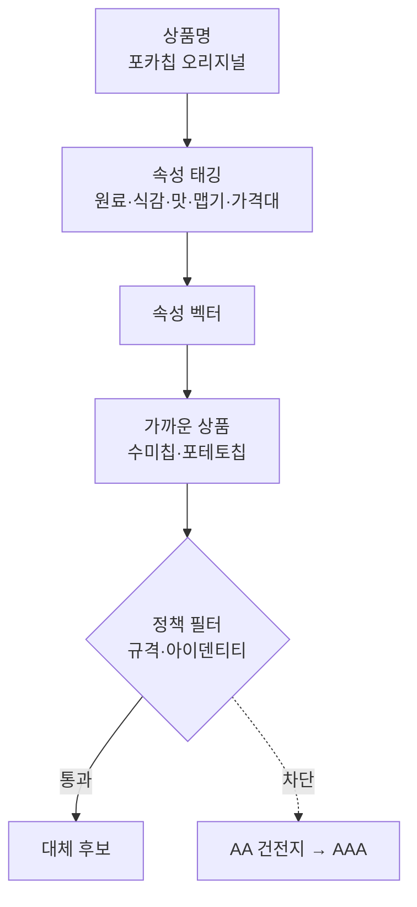

속성을 깊게 볼수록 좋아지지도 않았다. 노이즈 속성이 점수를 흐렸다. 종류마다 속성 깊이와 가중치를 바꿔 가며 정답셋으로 재고, 노이즈 속성 5개를 뺐다.

**결과.** 정답셋 종합 점수가 과자 0.842 → 0.866, 라면 0.907 → 0.944로 올랐다. (PR #1\~#6)

### 2. 목표 재정의: 품절 대체

**문제.** 대체·보완·콤보·트렌드를 한꺼번에 하다 보니, 어떤 추천이 좋은 추천인지 기준이 흐렸다.

**시도.** 목표를 "찾는 상품이 품절일 때 점원처럼 대신 권하기" 하나로 좁혔다. 그러자 대체에 방향이 있다는 게 보였다. 코카콜라를 찾는 손님에게 제로콜라는 괜찮지만, 제로를 찾는 손님에게 일반 콜라는 안 된다. 당·맵기·카페인을 방향별 정책으로 정했다.

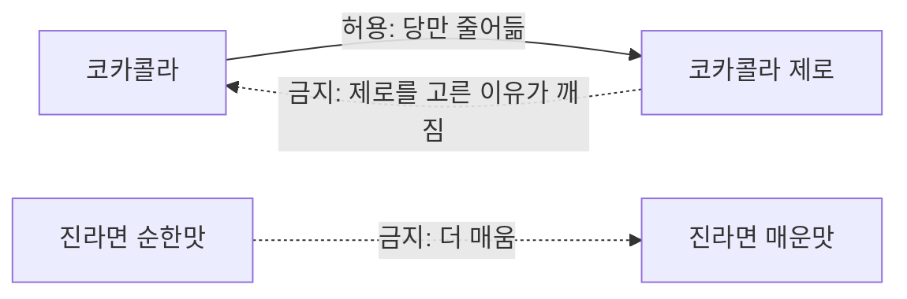
 사람에게는 모든 쌍을 묻지 않고, 정책으로 판단이 안 되는 16문항만 관리자에게 물었다.

**결과.** 외부 사람 라벨(Amazon ESCI, 편의점 관련 25,079쌍)과 대조해 정책 방향이 맞는지 확인했다. (PR #7\~#9)

### 3. 사람다움 측정: 페르소나 설문

**문제.** 실제 품절 판매 데이터가 없어서, 추천이 사람처럼 판단하는지 잴 방법이 없었다.

**시도.** 당뇨, 다이어트, 맵찔이, 브랜드 충성, 가격 민감 등 성향이 다른 페르소나 30명을 만들었다. 그리고 상품마다 "이게 품절이면 이 중 무엇을 대신 사겠나"를 물었다. 설문 결과로 상품쌍을 판정하고 정책을 고쳤다.

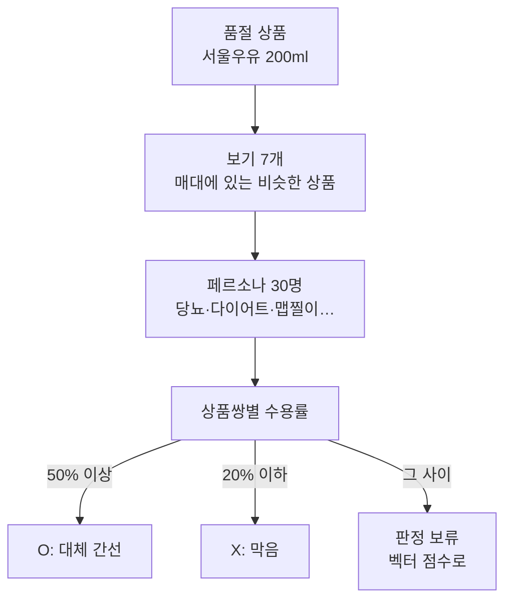

다수는 받아들이지만 소수가 꼭 거절하는 쌍은 따로 판단했다. 서울우유 → 바나나맛우유는 74%가 받아들이지만, 당뇨·다이어트 응답자는 전원 거절해서 막았다.

채점 기준도 화면에 맞췄다. 앱 화면에는 1\~3순위를 함께 보여 주므로, 손님이 셋 중 하나를 고르면 맞힌 것으로 본다.

**결과.** 손님이 셋 중 하나를 고른 비율은 94.6%였다. 1순위 적중은 인기순의 두 배 가깝다.

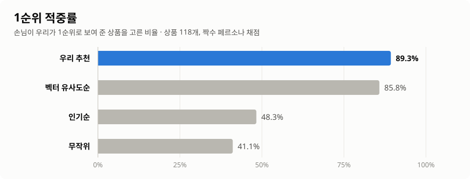

**한계.** 응답자가 전부 AI이고, 30명이 실제 GS앱 이용자 분포를 대변하지도 않는다. 이용자 분포는 비공개라 맞출 근거가 없다. (PR #10\~#15, #18, #19)

### 4. 설문 비용 절감: 선별 설문과 증류 모델

**문제.** 상품을 추가할 때마다 30명에게 다시 물어야 했다. 짜장라면 5개를 추가하는 데 13문항 × 30명, 약 166만 토큰이 들었다. 상품이 수천 개가 되면 감당할 수 없다. 당근 팀의 의견도 같았다. 후보를 먼저 좁히고, 애매한 것만 물으라는 것이었다.

**시도 1. 선별 설문.** 새 상품과 아직 확인 안 된 1\~3순위만, 그 카테고리를 실제로 사는 페르소나 5\~10명에게만 물었다. 상품 3개를 추가하는 데 80응답, 약 17만 토큰이 들었다.

**시도 2. 증류 모델.** 그래도 새 상품 문항은 상품 수만큼 늘어난다. 그래서 지금까지 쌓인 설문 판정 1,011쌍으로 "이 쌍을 몇 %가 받아들일까"를 예측하는 모델을 학습했다. 모델이 확신하는 쌍은 묻지 않고, 애매한 쌍만 설문으로 보낸다. O/X를 가르는 힘은 AUC 0.942로, 벡터 점수(0.869)나 정책 규칙(0.832)보다 높다.

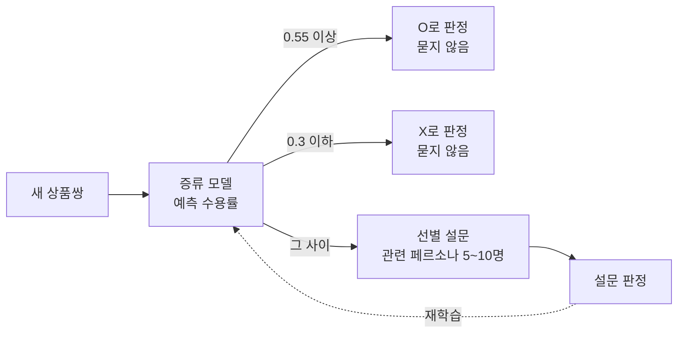

**결과.** 상품을 118개에서 238개로 늘릴 때 상품쌍은 4배가 됐지만, 토큰은 전수 재설문의 약 15%만 썼다.

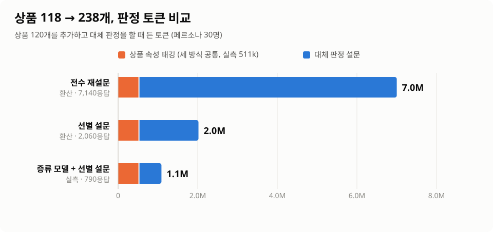

| 방식 | 응답 | 토큰 |
|---|---|---|
| 전수 재설문 (환산) | 7,140 | 약 7.0M |
| 선별 설문만 (환산) | 2,060 | 약 2.0M |
| **증류 모델 + 선별 설문 (실측)** | **790** | **1.09M** |

(PR #12, #16, #17, #21, #22 · [`docs/scale_up.md`](docs/scale_up.md))

### 5. 빈칸 해소: 카탈로그 확장

**문제.** 손님은 대신 살 게 있다고 했는데 우리가 아무것도 보여 주지 못한 경우가 4%였다. 처음에는 빈칸에 벡터 1순위라도 채워 보려 했다. 시뮬레이션해 보니 정책을 지키면 채울 상품이 하나도 없었다. 정책을 무시하면 마스크 → 생리대 같은 추천이 나왔다. 원인은 순위가 아니라, 같은 종류 상품이 하나뿐인 작은 카탈로그였다.

**시도.** 과자 40, 라면 30, 음료 30, 생필품 20개를 추가해 238개로 늘렸다. 속성 태깅은 에이전트 7개를 병렬로 돌렸다. 새 상품의 판정은 4번의 증류 모델과 선별 설문으로 했다.

모델 판정이 맞는지는 판정에 쓰지 않은 별도 검증 설문(새 상품 24개, 240응답)으로 확인했다.

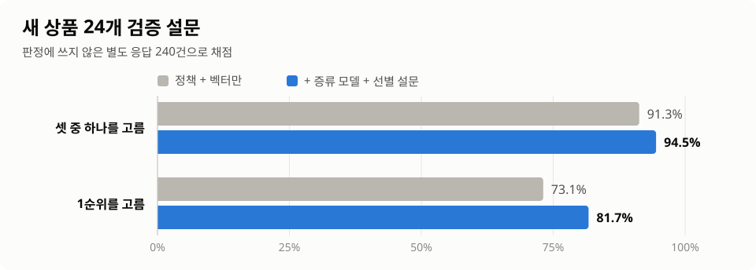

**결과.** "권할 대체 없음"이 9개에서 2개로 줄었다. 튀김우동, 우산, 서울우유도 이제 같은 종류로 대신 권한다.

**남은 문제.** 모델이 "받아들인다"고 확신한 쌍 중 15%는 검증 설문에서 대부분이 거절했다. 확신 기준을 높이는 것이 다음 과제다.

확장 직후 지표가 크게 떨어진 일도 있었다. 추천이 나빠진 게 아니라 채점이 틀린 것이었다. 일부 보기만 물은 응답에서 안 물은 보기를 "안 골랐다"로 셌다. 응답자가 본 적 없는 새 상품 추천도 오답으로 셌다. 이 두 경우를 채점에서 분리했다. (PR #20, #22)

### 6. 대체 관계 시각화

**문제.** 상품이 238개가 되자 어떤 상품끼리 서로 대신하는지 평면 지도 한 장으로는 읽기 어려웠다. 이름이 겹치고, 종류가 다른 묶음이 한 화면에 섞였다.

**시도.** 상품을 점, 대체 관계를 선으로 두고 3차원에 배치했다. 서로 대신할 수 있는 상품끼리 모이고, 과자·라면·음료·생필품은 떨어진다. 점이 클수록 대신할 상품이 많다.

**결과.** 음료 안에서도 물·차, 커피, 탄산, 주류가 따로 모였다. 생필품은 상품당 대체 관계가 2.3개로 과자(5.9)·라면(6.7)보다 훨씬 적다. 건전지·면도기처럼 규격이 맞아야 대신할 수 있는 상품이 많아서다.

[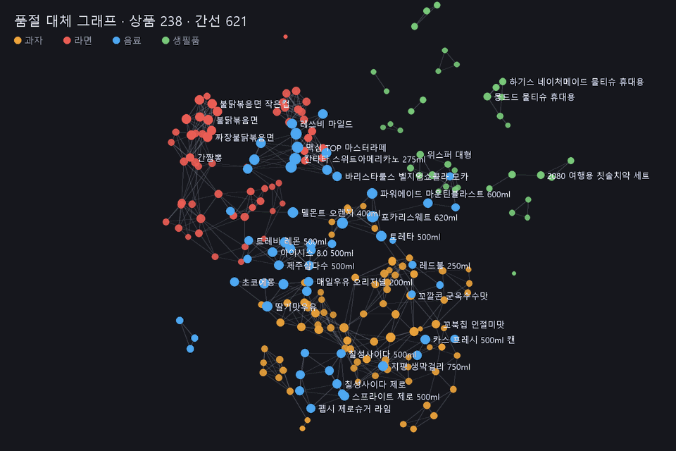](https://htmlpreview.github.io/?https://github.com/aeeengsungwoo/cvs-taxonomy/blob/main/docs/product_graph_3d.html)

(PR #3, #22)

### 다음 과제

- 증류 모델의 확신 O 기준 상향
- 설문과 정책이 부딪히는 36쌍 결정 (`review/conflicts.csv`)
- 실제 사람 설문으로 페르소나 교정
- 실제 GS 카탈로그 적용

## 품절 대체 추천

목표는 **찾는 상품이 품절일 때 점원처럼 대신 권하는 것**이다. 아래 정책·검수·벡터·관리자 판단은 전부 이 한 동작을 위해 있다.

```
python cvs.py oos "코카콜라 500ml"
코카콜라 500ml 품절
  1. 코카콜라 제로 500ml  — 같은 코카콜라 라인 · 당 없음
  2. 펩시콜라 500ml  — 같은 콜라
  3. 펩시 제로슈거 라임  — 같은 콜라 · 당 없음 · +과일
```

화면에는 1\~3순위를 함께 보여 준다. 1·2순위는 "대신 이건 어떠세요", 3순위는 확신이 낮아 흐리게 또는 "이것도 있어요"로 약하게 보여 준다.
괄호 안은 그 상품이 품절일 때 페르소나 설문에서 "대신 사겠다"고 한 비율이다([`docs/survey.md`](docs/survey.md)). "모델"은 설문 없이 증류 모델이 판정한 쌍이다([`docs/scale_up.md`](docs/scale_up.md)).

| 품절 상품 | 1순위 | 2순위 | 3순위 (이것도 있어요) | 사람처럼 판단한 점 |
|---|---|---|---|---|
| 코카콜라 500ml | 코카콜라 제로 500ml (73%) | 펩시콜라 500ml (모델) | 펩시 제로슈거 라임 (55%) | 같은 라인의 가벼운 버전 → 같은 콜라. 사이다는 밀려남 |
| 코카콜라 제로 500ml | 펩시 제로슈거 라임 (91%) | 칠성사이다 제로 (87%) | 스프라이트 제로 500ml (모델) | 제로끼리만. 다이어트·당뇨 응답자가 전원 거절한 일반 코카콜라는 빠짐 |
| 불닭볶음면 큰컵 | 까르보불닭볶음면 큰컵 (100%) | 불닭볶음면 (92%) | 로제불닭볶음면 큰컵 (모델) | 같은 불닭 라인을 따라감. 봉지 ↔ 컵도 됨 |
| 진라면 순한맛 | 진라면 순한맛 컵 (모델) | 삼양라면 (100%) | 안성탕면 (80%) | 같은 라인 컵이 먼저. 더 매운 진라면 매운맛은 권하지 않음 |
| 오모리 김치찌개라면 | 김치큰사발면 (100%) | 신라면 큰사발 (86%) | 왕뚜껑 (81%) | 같은 오모리 라인이 없으면 같은 김치 메뉴 |
| 짜파게티 | 짜파게티 더블랙 (모델) | 짜파게티 범벅 (모델) | 짜파게티 큰사발 (81%) | 같은 짜파게티 라인이 늘어서 라인 안에서 해결. 매운 사천짜파게티는 뒤로 |
| 2080 여행용 칫솔치약 세트 | 2080 칫솔 (97%) | 페리오 치약 소용량 (97%) | 페리오 칫솔 (모델) | 세트가 없으면 낱개로 |
| 빼빼로 오리지널 | 포키 초코 (모델) | 누드 빼빼로 (모델) | 가나 마일드 (83%) | 같은 초코 스틱이 생겨서 초콜릿보다 먼저 |
| 하늘보리 500ml | 광동 옥수수수염차 500ml (97%) | 광동 헛개차 500ml (모델) | 블랙보리 520ml (모델) | 차가 늘어서 물보다 차가 먼저 |
| 새우깡 | 꽃게랑 (93%) | 자갈치 (모델) | 오징어집 (모델) | 같은 소맥 튀김 스낵 |
| 신라면 (진라면 매운맛도 품절, 더운 날) | 신라면 블랙 (모델) | 신라면 컵 (모델) | 신라면 블랙 사발 (모델) | 같은 신라면 라인이 늘어서, 함께 품절인 진라면 없이도 라인 안에서 해결 |
| 팔도비빔면 | 배홍동 비빔면 (100%) | 팔도비빔면 컵 (모델) | 배홍동 큰사발 (모델) | 더 매운 진비빔면, 짜장라면(0%)은 권하지 않음 |
| 튀김우동 큰사발 | 가쓰오우동 큰컵 (모델) | 튀김우동 사발면 (모델) | 사골곰탕 큰컵 (모델) | 전에는 우동이 하나뿐이라 권할 게 없었음. 카탈로그를 늘려 해결 |
| 서울우유 200ml | 매일우유 오리지널 200ml (모델) | 남양 맛있는우유GT 200ml (모델) | — | 흰 우유끼리. 당뇨·다이어트 응답자가 거절한 바나나맛우유는 계속 막음 |
| 편의점 비닐우산 | 3단 접이식 우산 (모델) | 편의점 장우산 (모델) | — | 전에는 "권할 대체 없음". 같은 종류가 생기자 바로 채워짐 |

점원의 순서 (`ontology/policy.yaml oos`):
1. 같은 브랜드 라인 — 단 당·맵기·카페인이 조금이라도 세지는 쪽은 아님
2. 같은 세부 카테고리
3. 나머지. 같은 단계 안에서는 대체 강도순
4. 함께 품절인 상품, 지금 상황(TPO)에 안 맞는 상품은 뺀다. 단 손님이 고른 상품도 그 상황을 피하는 상품이면 손님 선택이 우선
5. 강도 0.6 미만이면 "권할 대체 없음"

전 상품 결과는 `out/oos_recommendations.csv` 에 있다(238개 중 236개 대체 있음. 없는 2개는 틈새라면 매운짜장, 리스테린 쿨민트).

### 페르소나 설문 측정

실제 품절 판매 데이터가 없어서, 성향이 다른 30명(당뇨·다이어트·임산부·맵찔이·브랜드 충성·가격 민감 등)을 생성형 에이전트로 만들었다. 상품 115개가 각각 품절일 때 매대의 보기 7개 중 무엇을 대신 사겠는지 물었다 → [`docs/survey.md`](docs/survey.md).
설문이 옳다고 가정하고 상품쌍 판정과 정책 6개(같은 라인 포장형태·당 방향, 매운 손님의 맵기, 세트 ↔ 낱개, 카테고리 묶음, 생리대 사이즈)에 반영했다.
설문과 정책이 부딪힌 24쌍은 `review/conflicts.csv` 에서 한 쌍씩 결정했다. 소수 보호와 "없으면 이거라도" 기준으로 16쌍은 정책을 유지했고, 8쌍은 예외로 허용했다.

화면에 1\~3순위를 보여 주고 손님이 그중 하나를 고르면 정답으로 본다(짝수 페르소나로 채점, 판정은 홀수 페르소나로).

상품 118개 시기 수치다(확장 뒤 새 상품은 개발 과정 5번의 검증 설문 참고).

| 지표 | 값 |
|---|---|
| 3개 중 하나를 고름 (선택률) | **94.6%** |
| 1순위를 고름 | 89.3% |
| 살 게 있는데 아무것도 안 보여 줌 (빈손) | 3.6% |
| 보여 준 것 중 안 고른 것 (헛추천) | 13.8% |

순위별 과반 수용은 1순위 96% · 2순위 93% · 3순위 82%다.

인기순·벡터 유사도순과 같은 조건(응답자가 본 보기 안에서 3개)으로 비교했다([`docs/rank_eval.md`](docs/rank_eval.md)).

| 방법 | P@3 | 보인 것 중 맞음 | R@3 | NDCG@3 | 1순위 |
|---|---|---|---|---|---|
| **우리 추천** (평균 2.08개) | 0.603 | **0.889** | 0.711 | **0.805** | **0.893** |
| 인기순 | 0.490 | 0.490 | 0.553 | 0.571 | 0.483 |
| 벡터 유사도순 | 0.643 | 0.643 | 0.762 | 0.827 | 0.858 |
| 벡터 유사도순 (우리와 같은 개수) | 0.544 | 0.795 | 0.627 | 0.724 | 0.839 |

인기순보다 1순위 적중이 두 배 가깝다. 같은 개수로 보여 주면 벡터보다도 낫다. 3개를 꽉 채우는 벡터가 P@3은 더 높은데, 이는 우리가 확신이 없으면 비워 두기 때문이다(권할 대체 없음 47건). 3순위는 확신이 낮으니 흐리게 표시하거나 "이것도 있어요" 정도로 약하게 보여 주는 것을 권한다 → [`docs/survey.md`](docs/survey.md#3개-보여-주기-기준-평가).

### 한계와 다음 단계

[`docs/limits_and_next.md`](docs/limits_and_next.md) 에 정리했다.
- **한계:**
  - 판단 주체가 거의 전부 AI다(실제 사람 검수는 1건).
  - 페르소나 30명이 실제 GS앱 이용자 분포를 대변하지 않는다. 이용자 분포는 비공개라 맞출 근거가 없다.
  - 상품이 늘면 설문 비용도 커진다.
  - 설문이 갈린 쌍은 옛 AI 라벨이 남는다.
  - 같은 종류 상품이 하나뿐이면 권할 게 없다.
  - 카테고리 트리와 손님의 대체 경계가 어긋난다(트리만으로 AUC 0.72).
- **대안:**
  - 당근 방식처럼 애매한 쌍만, 관련 페르소나에게만 묻는다(완료: `tools/survey_queue.py`, 상품 3개 추가에 약 17만 토큰).
  - 설문 판정으로 증류 모델을 학습해 확신하는 쌍은 묻지 않는다(완료: 상품 120개 추가에 설문 58만 토큰).
  - 실제 사람 20문항 설문으로 페르소나를 교정한다.
  - 택소노미 적합도(`cvs.py taxofit`)로 대체용 묶음을 정한다.
  - 같은 종류 상품을 채운다(완료: 118 → 238개, 권할 대체 없음 9 → 2).

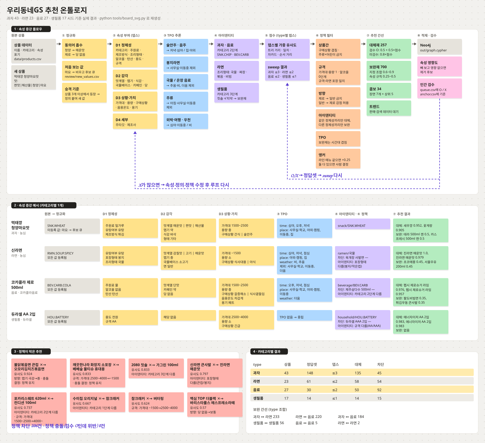

> 보드는 실제 파이프라인 결과로 생성된다. 데이터·정책을 바꾸면 `python tools/board_svg.py` 로 다시 그린다.

## 범위

| type | 시드 상품 | 정답셋(O/X) | 설문 판정(O/X) | 선택 뎁스 | AUC | MRR | 대체 간선(방향) | 정책 차단(방향) |
|---|---|---|---|---|---|---|---|---|
| 과자 | 43 | 148 | 191 | ≤3 | 0.849 | 0.883 | 137 | 45 |
| 라면 | 28 | 64 | 134 | ≤2 | 0.955 | 0.933 | 85 | 51 |
| 음료 | 27 | 30 | 99 | ≤2 | 1.000 | 1.000 | 50 | 92 |
| 생필품 | 17 | 14 | 15 | ≤1 | 0.833 | 0.706 | 14 | 15 |

대체 간선은 방향이 있다(a 찾는 손님에게 b). 코카콜라 → 제로는 먼저 권하고, 제로 → 코카콜라는 다른 제로가 다 없을 때만 맨 뒤로 권한다.

보완 간선 740 · 콤보 34 (장면 7개) · 트렌드는 데이터 대기.
정답셋 256쌍 = 시드 78 + AI 검수 152 + 관리자(AI) 25 + 사람 검수 1. 페르소나 설문 판정 703쌍(O 272 · X 431, 갈림 128은 판정 없음)은 사람 검수 다음으로 우선한다. Neo4j 5.26 로컬 적재 검증 완료(노드 462 · 관계 3,605).

## 속성 증강 플로우

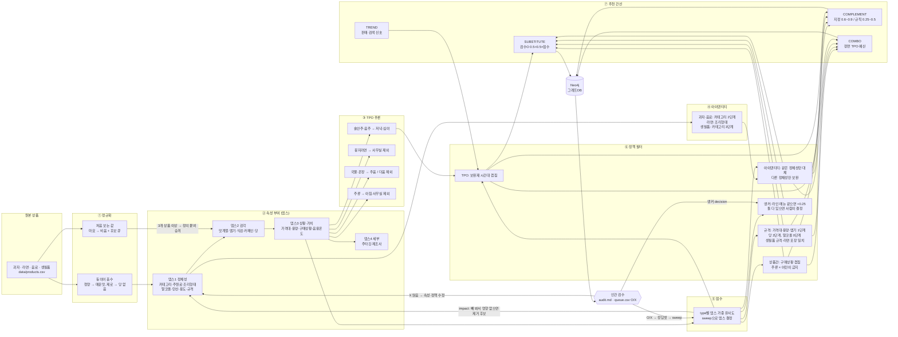

## 그래프 스키마

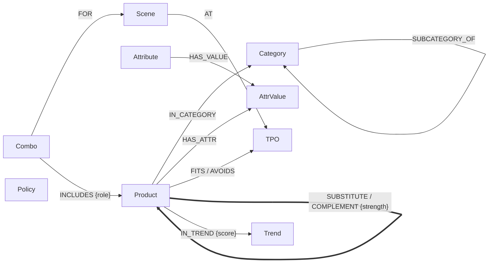

## 텍소노미와 속성 뎁스

카테고리 71노드, 속성 27개(점수용 25 + 앵커 정책 전용 2). 모든 카테고리·속성·값에 정의가 있다(`validate` 가 빠진 정의를 실패 처리).

| 뎁스 | 의미 | 공통 | 과자 | 라면 | 음료 | 생필품 |
|---|---|---|---|---|---|---|
| 1 정체성 | 무엇인가 | 카테고리 | 주원료·유탕·제조방식 | 유탕·포장형태·조리형태 | 주원료·알코올·탄산 | 용도·규격 |
| 2 감각 | 어떤 맛인가 | 맛계열 | 맵기·식감·형태 | 맵기·국물베이스·면 | 카페인·당 | — |
| 3 상황·가치 | 언제·얼마에 | 가격대·용량·구매상황 | | | 음용온도·용기 | |
| 4 세부 | 누가 | 주타깃·제조사 | | | | |

뎁스는 type별로 sweep이 정한다. 뎁스 1\~4마다 뎁스별 가중치 배수(0.25/0.5/1/2)를 전부 돌려,
정책까지 적용한 최종 추천을 정답셋 기준 AUC·MRR로 재고 성능이 거의 같으면(0.01 이내) 얕은 뎁스를 고른다.
처음 시드 정답셋(9\~33쌍)에서는 과자가 제조사 배수 2로 과적합됐다. 검수 루프 4회로 정답셋을 늘리자 과자는 ≤3으로 내려왔고 제조사는 점수에서 빠졌다.

### 속성 영향도

`python cvs.py impact` 가 속성을 하나씩 빼 보고(가중치 0) 성능 변화와 상위 5 추천 변동률을 잰다.
정책·TPO가 쓰는 속성은 점수 영향과 무관하게 유지하고, 나머지는 기준에 따라 유지·보류·제거를 정한다 → [`docs/attribute_impact.md`](docs/attribute_impact.md).

| 판정 | 속성 |
|---|---|
| 보관 — 가중치 0 (노이즈) | 과자 제조방식, 라면 국물베이스 |
| 보관 — 가중치 0 (영향 미미) | 과자·라면 유탕여부, 라면 면, 음료 카페인 |
| 그대로 둠 (뎁스 밖이라 이미 점수에 안 씀) | 제조사, 음료 용기 |
| 기여 큰 속성 | 과자 맛계열·주원료·식감, 라면 맵기·카테고리, 음료 카테고리·당 |

보관은 정의·데이터를 남기고 점수에서만 뺀다. 정리 후 종합 점수가 과자 0.842 → 0.866, 라면 0.907 → 0.944로 올랐다.
국물베이스가 노이즈였던 이유: 손님은 소고기·된장·해물 베이스를 구분하지 않고 얼큰한 국물이면 서로 대체한다(신라면 ↔ 안성탕면 ↔ 너구리).

## 방향 정책 · 상품 벡터 · 관리자 HITL

> 코카콜라를 사러 온 손님에게 제로콜라를 권하면 잘된 추천인가? — **방향에 따라 다르다.**
> 코카콜라 → 제로는 잃는 게 당뿐이라 감점 허용, 제로 → 코카콜라는 제로를 고른 이유를 깨므로 금지.

[](https://htmlpreview.github.io/?https://github.com/aeeengsungwoo/cvs-taxonomy/blob/main/docs/product_graph_3d.html)

3D 그래프: `python tools/product_graph3d.py` · GIF: `python tools/graph3d_gif.py`

<details>
<summary>종류별 2D 벡터 지도</summary>

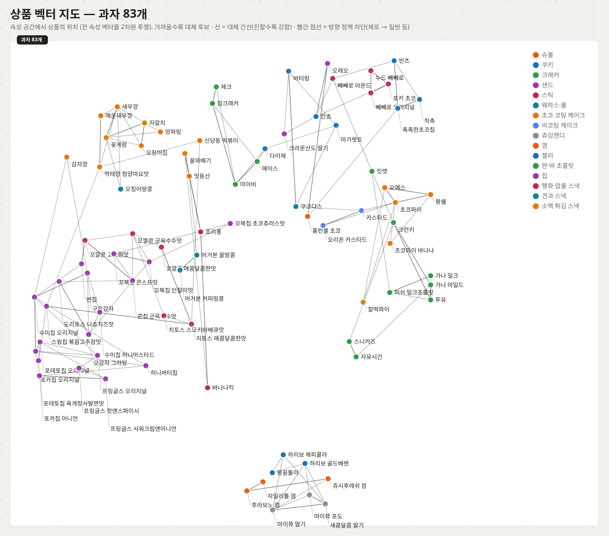

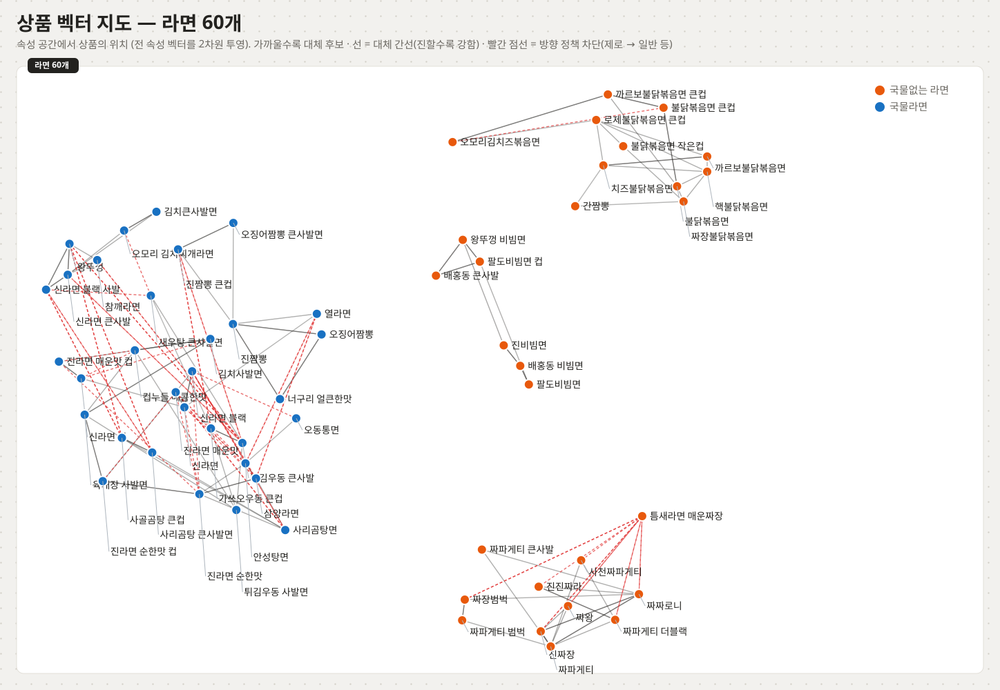

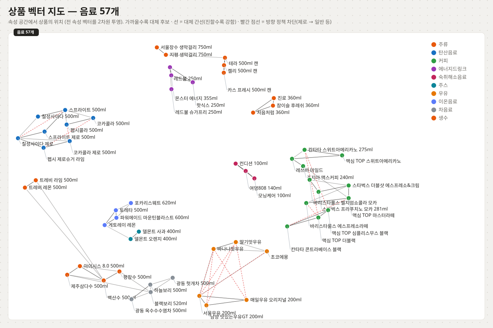

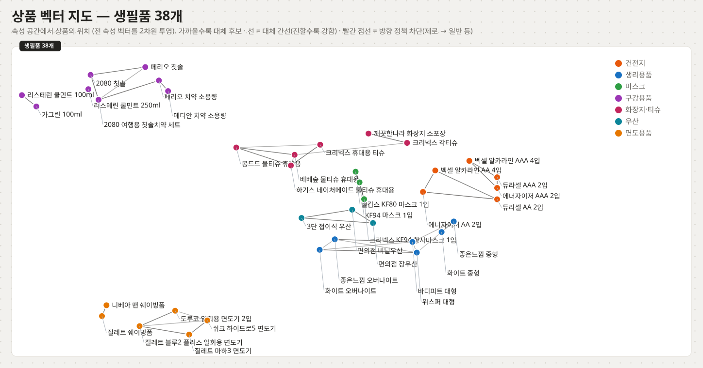

</details>

| 구성 | 하는 일 |
|---|---|
| 방향 정책 | 당·맵기·카페인은 찾는 상품 → 권할 상품 방향별로 허용 단계가 다르다. 제로·저당에서 당이 오르는 쪽은 무조건 금지 |
| 상품 벡터 | 상품을 속성 공간의 벡터로 놓는다(위 지도). 가까운 5개가 대체 후보 |
| 자동 판정 | 비슷한 검수 쌍이 충분하면 그 판단을 따라 자동 승인·거절 (라벨 전파) |
| 관리자 HITL | 손님에게는 묻지 않는다. 관리자에게 **정책 문항**(답 1개가 수십 쌍 결정)과 근거가 부족한 상품쌍만 묻는다 |

관리자 질문 18개(정책 2 + 상품쌍 16)에 AI가 관리자 역할로 답했다(`review/admin_queue.csv` note에 근거). 당 내림 O, 맵기 올림(중 이상) X. 남은 질문 0개.
포함 정책: 세트는 구성품을 대신할 수 있다(칫솔 품절 → 여행용 칫솔치약 세트, 반대는 안 됨).
기획과 판정 기준은 [`docs/hitl_plan.md`](docs/hitl_plan.md).

### Amazon ESCI 검증

Amazon ESCI(검색어 × 상품 260만 쌍, 사람 라벨 E/S/C/I) 중 편의점 관련 25,079쌍으로 정책을 대조했다 → [`docs/esci_check.md`](docs/esci_check.md).
검색 적합도 라벨이라 품절 대체의 정답으로는 못 쓰지만(디카페인 질의에 일반 커피 E 등), 두 가지는 쓸 만하다.
- 브랜드 충성도는 카테고리마다 다르다: 펩시 질의 → 다른 브랜드 87% I, 듀라셀·농심 질의 → 다른 브랜드 86\~93% S.
- 규격(AA ↔ AAA)은 I가 기준선 0% 대비 19\~50%로 높다 — 금지 유지.

## 정책 (튀는 추천 방지)

`ontology/policy.yaml`. 점수와 별개인 하드 조건이다. 위반하면 간선을 만들지 않고 `out/audit.md` 에 사유를 남긴다.

| 정책 | 내용 | 막은 예 |
|---|---|---|
| 아이덴티티 | 같은 정체성끼리만 대체, 다른 정체성끼리만 보완 | 짜파게티 → 비빔면 (조리형태 다름) |
| 상품간 | 대체재는 구매상황이 겹쳐야 함 | 하리보 → 자일리톨 껌 (간식 vs 입가심) |
| 규격 | 가격대·용량 1단계, 알코올 0단계, 생필품 규격 일치, 라면 포장형태 일치 | AA → AAA, 맥주 → 소주 |
| 방향 | 제로·저당에서 당 올림 금지, 맵기·카페인 1단계까지 (올리는 쪽 감점) | 코카콜라 제로 → 코카콜라, 튀김우동 → 육개장 사발면 |
| 제한 상품 | 주류 × 어린이 상품 보완·콤보 금지 | — |
| TPO | 보완재는 시간대가 겹쳐야 함 | 해장 라면 + 게토레이 |

### 대체 기준(앵커)

불닭볶음면을 찾는 손님에게는 같은 라인(까르보불닭)을, 다른 손님에게는 같은 메뉴를 권해야 할 수 있다.
상품마다 앵커를 `line`(브랜드 라인) / `menu`(대표 메뉴) / `category` 중 하나로 정한다 → [`docs/anchor_policy.md`](docs/anchor_policy.md).

| 조건 | 앵커 |
|---|---|
| 라인·메뉴가 둘 다 이름에 있음 (오모리 김치찌개, 까르보불닭) | 결정 칸으로 정함 (`review/anchor.csv` decision) — 현재 3개 모두 line |
| 같은 라인 후보가 있음 (불닭볶음면) | line |
| 같은 메뉴 후보가 있음 (진짬뽕) | menu |
| 그 외 | category (속성 유사도만) |

앵커가 같으면 유사도 +0.25, 상위 k 밖이어도 후보에 넣는다. 하드 정책은 못 뚫는다(코카콜라 → 제로는 여전히 금지).

검수에서 O를 받았는데 정책에 걸리면 '정책 충돌'로 따로 보고한다. 현재 1건(2080 칫솔 ↔ 여행용 칫솔세트) — 정책과 검수 중 어느 쪽이 맞는지 사람이 정한다.

## TPO와 콤보

상품마다 TPO를 찍지 않고 속성에서 추론한다(`ontology/tpo.yaml`). 새 상품도 속성만 채우면 TPO가 따라온다.

- 시간대: 아침 · 점심 · 오후 · 저녁 · 심야 / 장소: 집 · 사무실·학교 · 야외·캠핑 · 이동중 / 날씨: 더움 · 추움 · 비
- 예: 봉지라면 → 사무실 제외, 국물·온장 커피 → 더움 제외, 주류 → 아침·사무실·이동중 제외, 우산 → 비

콤보 장면 7개: 심야 혼술·야식, 사무실 점심 컵라면, 오후 사무실 나눔 간식, 캠핑 저녁, 더운 날 점심, 비 오는 날 퇴근길, 갑작스런 외박.
장면 TPO에 맞고, 정체성이 겹치지 않고, 제한 정책을 지키고, 예산 안인 조합만 남긴다.

## 간선 강도

| 관계 | 강도 |
|---|---|
| 대체 — 검수 O | 0.5 + 0.5 × 유사도 (바닥 0.5) |
| 대체 — 검수 X | 간선 없음 |
| 대체 — 미검수 | 0.8 × 유사도 (상품당 상위 5, 유사도 0.55 이상) |
| 보완 — 지정 조합 | 사람이 정한 값 (짜파구리 0.9, 칫솔+치약 0.9, 불닭+우유 0.7 …) |
| 보완 — 속성 규칙 | 0.25 \~ 0.5 (안주+맥주 0.5, 매운 라면+우유 0.45 …) |
| 콤보 궁합 | 상품쌍 보완 강도 평균, 없으면 시간대 겹침 × 0.3 |

## 루프

```
python cvs.py validate        # 1. 정의 누락·처음 보는 값 점검 → review/new_values.csv
python cvs.py sweep           # 2. type별 뎁스·가중치 튜닝 → config/weights.yaml
python cvs.py review export   # 3. 검수 후보 → review/queue.csv (정책 차단 쌍은 제외)
#    queue.csv 의 verdict 칸에 O(대체 가능) / X(아님) 입력
python cvs.py review import   # 4. 검수 결과 → review/gold.csv (AI 1차 검수는 --source claude)
python cvs.py sweep           # 5. 늘어난 정답셋으로 다시 튜닝 (2~5 반복)
python cvs.py anchor          #    대체 기준 판정 → review/anchor.csv (pending 은 사람이 decision 칸에)
python cvs.py impact          #    속성 영향도 → out/attribute_impact.csv
python cvs.py triage          #    벡터 근처 후보 자동 판정 + 관리자 질문 → review/admin_queue.csv
python cvs.py admin           #    관리자 답 반영 (상품쌍 → gold.csv, 정책 문항 → 방향 정책)
python cvs.py survey          #    페르소나 설문 판정·검증·평가 → out/survey_*.csv (docs/survey.md)
python tools/survey_queue.py  #    선별 설문 대기열: 새 상품 + 확인 안 된 1~3순위만, 관련 페르소나 5~10명 → survey/queue.json
python tools/survey_merge.py <라운드> <응답.json>...  # 선별 응답을 survey/answers/ 에 덧붙임
python cvs.py distill        #    증류 모델 검증 (AUC · 새 상품 가정 · 검증 설문) → out/distill_eval.csv (docs/scale_up.md)
python tools/survey_merge.py --validation <라운드> <응답.json>...  # 검증 설문 → survey/validation/ (판정에 안 씀, 채점만)
python cvs.py rankeval        #    추천 지표 P@3 · R@3 · NDCG@3 vs 인기순 · 벡터 · 무작위 → out/rank_eval.csv (docs/rank_eval.md)
python cvs.py taxofit         #    택소노미 적합도 (트리 거리 ↔ 설문 대체) → out/taxonomy_fit.csv (docs/limits_and_next.md)
python cvs.py oos --all       #    전 상품 품절 대체 → out/oos_recommendations.csv
python cvs.py graph           # 6. out/graph.cypher · out/edges.csv · out/audit.md
python tools/board_svg.py     # 7. README 보드 갱신
python tools/product_map.py   #    상품 벡터 지도 갱신 (종류별 4장)
python tools/product_graph3d.py  # 3D 그래프 → docs/product_graph_3d.html
python tools/token_chart.py   #    판정 토큰 차트 → docs/token_cost.svg (survey/cost_log.yaml)
```

X가 많이 나오면 스키마나 정책이 그 차이를 못 잡는다는 뜻이다. 그 쌍을 보고 속성·정의·정책을 고친 뒤 루프를 다시 돈다.
새 카테고리를 넣는 절차와 생필품·음료 대응방침은 [`docs/new_category_policy.md`](docs/new_category_policy.md), 처음 보는 속성 대응은 [`docs/unknown_attribute_policy.md`](docs/unknown_attribute_policy.md).

## Neo4j 적재

```
docker compose up -d
pip install neo4j
NEO4J_PASSWORD=cvs-taxonomy python cvs.py graph --push
```

Docker 없이 쓰려면 Neo4j Browser/AuraDB에 `out/graph.cypher` 를 실행한다. 재실행하면 노드는 MERGE, 추천 간선·콤보는 지우고 다시 만든다.

포터블 JDK 21 + Neo4j Community 5.26 으로 로컬 적재를 검증했다(적재 약 30초).

```cypher
// 불닭볶음면 큰컵 대체재 (anchor = line)
MATCH (:Product {name:'불닭볶음면 큰컵'})-[r:SUBSTITUTE]->(p) RETURN p.name, r.strength, r.anchor
// 신라면 대체재
MATCH (:Product {name:'신라면'})-[r:SUBSTITUTE]->(p) RETURN p.name, r.strength ORDER BY r.strength DESC
// 카스와 같이 살 것
MATCH (:Product {name:'카스 프레시 500ml 캔'})-[r:COMPLEMENT]-(p) RETURN p.name, r.strength, r.reason ORDER BY r.strength DESC
// 비 오는 날 퇴근길 콤보
MATCH (c:Combo)-[:FOR]->(:Scene {id:'rainy_commute'}), (c)-[i:INCLUDES]->(p) RETURN c.rank, i.role, p.name ORDER BY c.rank
```

## 파일

| 경로 | 내용 |
|---|---|
| `taxonomy/categories.yaml` | 카테고리 트리 (과자·라면·음료·생필품), 노드마다 정의 |
| `taxonomy/schema.yaml` | 속성 27개 · 뎁스 · 값마다 정의 · 동의어 |
| `ontology/policy.yaml` | 아이덴티티 · 대체재 · 규격 · 보완재 · 제한 상품 · 콤보 · 트렌드 · 앵커 · 속성 영향도 기준 |
| `ontology/tpo.yaml` | TPO 차원 · 속성→TPO 추론 규칙 · 콤보 장면 7개 |
| `data/products.csv` | 상품 238개. 다중값은 `\|` 로 구분 |
| `data/trends.csv` | 트렌드 신호(판매·검색). 현재 비어 있음 |
| `review/gold.csv` · `review/queue.csv` | 검수 정답셋(source: seed · claude · admin · review) · 검수 대기. 설문 판정은 review 다음으로 우선 |
| `review/anchor.csv` | 상품별 대체 기준 판정 · 사람 결정 칸 |
| `review/admin_queue.csv` · `review/auto_labels.csv` | 관리자 질문(정책 문항·상품쌍) · 자동 판정과 근거 |
| `review/conflicts.csv` | 정책 충돌(라벨 O인데 정책 위반) 결정 — 허용(그 쌍만 예외) / 유지 |
| `out/esci_policy_check.csv` · `out/esci_samples.csv` | ESCI 사람 라벨로 본 정책별 E/S/C/I 분포 · 샘플 |
| `survey/personas.yaml` · `survey/questions.json` · `survey/answers/` | 설문 응답자 30명 · 품절 문항 115개 · 응답 |
| `out/survey_pairs.csv` · `out/survey_features.csv` · `out/survey_eval.csv` | 설문 판정 · 차이 유형별 수용률 · 추천 vs 설문 평가 |
| `out/rank_eval.csv` | 추천 지표와 기준선 비교 |
| `out/taxonomy_fit.csv` | 중분류를 넘는데 설문 O인 노드 쌍 (대체용 경계 재검토 후보) |
| `out/oos_recommendations.csv` | 상품별 품절 시 대신 권할 상품 3개와 이유 |
| `out/product_vectors.csv` · `docs/product_map_*.svg` | 상품 벡터 지도 좌표·가장 가까운 3개 · 종류별 지도 |
| `docs/product_graph_3d.html` · `docs/product_graph_3d.gif` | 돌려 볼 수 있는 3D 대체 그래프 · README용 회전 미리보기 |
| `out/distill_eval.csv` · `out/distill_coef.csv` | 증류 모델 검증 · 특징별 계수 |
| `survey/validation/` · `survey/validation_questions.json` | 새 상품 검증 설문 (채점 전용) |
| `survey/cost_log.yaml` · `docs/token_cost.svg` | 판정 토큰 실측 기록 · 차트 |
| `out/edges.csv` · `out/graph.cypher` | 추천 간선(강도·검수 상태·앵커) · Neo4j 적재 스크립트 |
| `out/products_enriched.csv` | 속성 증강 결과 (정규화 속성 + 추론 TPO + 아이덴티티) |
| `out/combos.csv` · `out/blocked.csv` · `out/audit.md` | 콤보 · 정책 차단/충돌 목록 · 검수용 리포트 |
| `out/attribute_impact.csv` | 속성 영향도 판정 |
| `config/weights.yaml` | sweep 결과 (type별 뎁스·배수) |
| `docs/design.md` · `docs/design.pdf` | 설계 문서 |
| `docs/board.svg` | 위 보드 |

## 주의

- 시드 상품의 속성값·가격대와 정답셋은 일반 지식 기반 초안이다. 정답셋 중 152쌍과 앵커 결정 3개는 AI 판단(`source=claude`, note에 근거)이다. 사람이 다르게 보면 해당 칸만 고치면 된다.
- 트렌드는 판매·검색 데이터가 없어 비워 두었다. 근거 없는 점수를 만들지 않는다(`data/trends.csv` 에 넣으면 `IN_TREND` 간선이 생긴다).
- 콤보 궁합은 규칙 기반이다. 장바구니(동시구매) 데이터가 생기면 보완 강도를 그 값으로 대체한다.
