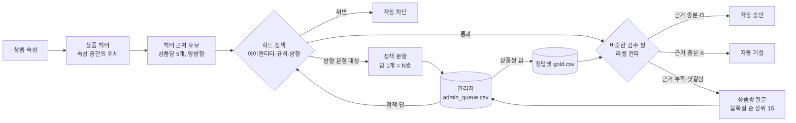

# 방향 정책 · 상품 벡터 · 관리자 HITL 기획

최종 목표는 **품절일 때 점원처럼 대신 권하기**(`python cvs.py oos`)다. 이 문서는 그 판단을 손님에게 묻지 않고 구축 단계에서 만드는 방법이다.

## 출발 질문 — 코카콜라를 사러 왔는데 제로콜라를 추천하면 잘된 추천인가

**방향에 따라 답이 다르다.**

| 찾는 상품 → 권할 상품 | 판단 | 이유 |
|---|---|---|
| 코카콜라 → 코카콜라 제로 | 조건부 허용 (감점) | 브랜드·맛·용도가 같다. 잃는 것은 '당'뿐이고, 당이 줄어드는 쪽은 손님에게 해가 없다. 다만 단맛 만족도는 떨어질 수 있어 강도를 깎는다 |
| 코카콜라 제로 → 코카콜라 | 금지 | 제로를 고른 이유가 바로 당이다. 건강 제약(당뇨·다이어트)을 깨는 추천은 한 번만 나와도 신뢰를 잃는다 |

예전 정책은 당 차이를 **양방향 대칭**(차이 2단계 초과 금지)으로 걸어서 둘 다 막았다. 그래서 대체 간선을 **방향 있는 관계**(a 찾는 손님에게 b)로 바꾼다.

## 원칙

1. **손님에게는 묻지 않는다.** 추천 시점에 "제로 괜찮으세요?"를 묻지 않는다. 판단은 구축 단계에서 끝낸다.
2. **관리자에게만, 적게 묻는다.** 상품쌍마다 묻지 않고 **정책 한 문항**으로 수십 쌍을 한 번에 정한다. 상품쌍 질문은 근거가 부족하거나 엇갈리는 것만 남긴다.
3. **이미 내린 판단은 비슷한 쌍으로 번진다.** 사람이 한 번 O/X를 준 쌍과 비슷한 새 쌍은 자동 판정한다(벡터 근처).

## 구성

### 1. 방향 정책 (`ontology/policy.yaml` substitute.direction)

| 속성 | 올라가는 쪽 (up) | 내려가는 쪽 (down) | 관리자 문항 |
|---|---|---|---|
| 당 | 1단계까지. **단 제로·저당(없음·적음)에서 올라가는 건 무조건 금지** | 허용, 강도 −0.15 | 내려가는 쪽: "당 높은 상품 → 제로·저당 대체 허용?" |
| 맵기 | 1단계, 강도 −0.1 | 1단계 | 올라가는 쪽: "덜 매운 상품 → 한 단계 더 매운 상품 허용?" |
| 카페인 | 1단계, 강도 −0.1 (사이다 → 콜라). 디카페인 → 일반 커피는 금지 | 허용 | — |

- 같은 쌍의 반대 방향 라벨을 빌려 쓰지 않는다. 방향 속성이 다른 쌍은 방향마다 따로 판정한다.
- 시드 정답셋에 방향이 거꾸로 적힌 라벨 2개를 바로잡았다(코카콜라 → 제로 X였던 것을 제로 → 코카콜라 X로).
- 사람이 O를 준 라떼(당 보통) → 스위트아메리카노(당 많음)가 처음 규칙(당 up 0)에 막혀서, 금지 조건을 '출발값이 제로·저당일 때'로 좁혔다.

### 2. 상품 벡터 — 상품의 위치

- 상품을 속성 공간의 단위 벡터로 놓는다(`cvs.embed`). 대체 점수와 **같은 속성·같은 가중치**를 쓴다.
  - 트리 속성(카테고리): 경로의 각 단계를 한 칸씩 (SNK, SNK.CHIP, SNK.CHIP.POTATO)
  - 순서 속성(맵기·가격대): 온도계 인코딩. 가까운 단계일수록 많이 겹친다
  - 다중값(맛계열): 값마다 한 칸
- 벡터 내적 = 비슷함. 상품당 가장 가까운 5개를 후보로 뽑는다. 상품이 수천 개가 되면 이 벡터를 그대로 ANN 인덱스(Neo4j 벡터 인덱스 등)에 넣는다.
- 지도: `docs/product_map.svg` — 전 속성 벡터를 type별로 2차원에 투영했다. 선은 대체 간선, 빨간 점선은 방향 정책이 막은 쌍이다.
- 매대 진열 위치(플래노그램) 데이터가 생기면 같은 벡터에 진열 구역·칸 좌표를 칸으로 붙인다. 매장은 대체재를 옆에 진열하므로 좋은 신호지만, 지금은 데이터가 없어 넣지 않았다.

### 3. 자동 판정 — 라벨 전파 (`cvs.py triage`)

(a → b)와 비슷한 검수 쌍 (c → d)를 찾는다. 비슷함 = cos(a, c) × cos(b, d), 방향 속성의 이동 방향도 같아야 한다.

| 조건 (`policy.yaml hitl`) | 결과 |
|---|---|
| 하드 정책 위반 | 자동 차단 |
| 방향 정책 문항 대상 | 정책 답(없으면 기본값)으로 결정, 상품쌍 질문 안 함 |
| 비슷한 검수 쌍 유사도 합 ≥ 1.5, O 비율 ≥ 0.8 | 자동 승인 → 간선 강도 0.45 + 0.4 × 유사도 (사람 O보다 낮음) |
| 같은 조건에서 O 비율 ≤ 0.2 | 자동 거절 → 간선 없음 |
| 그 외 (유사도 ≥ 0.55) | 관리자 상품쌍 질문 후보. 불확실한 순으로 15개까지 |

판정 근거(어느 검수 쌍을 따라갔는지)는 `review/auto_labels.csv`, `review/admin_queue.csv` 의 evidence 칸에 남는다.

### 4. 관리자 HITL (`review/admin_queue.csv` → `cvs.py admin`)

| 칸 | 내용 |
|---|---|
| kind | `policy`(정책 문항) / `pair`(상품쌍) |
| question | 예: "당 높은 상품 → 제로·저당 상품 대체 허용 (예: 코카콜라 → 코카콜라 제로)" |
| suggestion | 기본값 또는 비슷한 검수 쌍 기준 제안 |
| affects | 정책 문항이 결정하는 상품쌍 수 / 상품쌍 유사도 |
| answer | 관리자가 O / X |

- 정책 문항 답이 X면 그 방향 허용 단계가 0이 된다. 답이 비어 있으면 기본값으로 돈다 — 관리자가 답하지 않아도 시스템은 멈추지 않는다.
- 상품쌍 답은 `cvs.py admin` 이 정답셋으로 옮긴다(`source=admin`). 다음 `triage` 때 그 판단이 비슷한 쌍으로 번진다.

## 현재 결과

| 항목 | 값 |
|---|---|
| 대체 간선 (방향 있음) | 234 (검수 O 190 · 미검수 44) |
| 정책 차단 | 233 (방향 정책 포함) |
| 관리자 질문 | **16개** = 정책 2 + 상품쌍 14 |
| 정책 문항 2개가 결정하는 상품쌍 | 당 내림 14쌍 · 맵기 올림 71쌍 |
| 자동 판정 | 거절 2 (근거: 비슷한 검수 쌍 3~4개가 전부 X) |

코카콜라 관련 간선:

| 방향 | 결과 |
|---|---|
| 코카콜라 → 코카콜라 제로 | 간선 0.68 (미검수, 당 내림 −0.15). 정책 문항 답을 기다림 |
| 코카콜라 제로 → 코카콜라 | 차단 (방향: 당 없음 → 많음) |
| 코카콜라 제로 → 펩시 제로슈거 | 간선 1.0 (검수 O) |
| 칠성사이다 → 코카콜라 | 관리자 상품쌍 질문 (카페인이 오르는 쪽이라 반대 방향 라벨을 빌리지 않음) |

## 관리자 답 (AI가 관리자 역할로 답함)

| 문항 | 답 | 근거 |
|---|---|---|
| 당 높은 상품 → 제로·저당 대체 | O | 당만 빠지는 쪽은 손님에게 손해가 없다. 같은 라인이면 점원도 제로를 먼저 권한다 |
| 덜 매운 상품 → 한 단계 더 매운 상품(중 이상) | X | 순한맛은 매운 걸 못 먹어서 고르는 경우가 많다. '약'까지 오르는 것(새우깡 → 먹태깡)은 이 문항 대상이 아니다 |
| 상품쌍 16개 | O 9 · X 7 | 이전 검수와 같은 기준(맛이 정체성인 상품은 맛이 다르면 X, 반대 방향 O는 대부분 O) |

답하는 과정에서 정책 두 개를 고쳤다.
- 맵기: '약'까지 올라가는 것은 방향 정책 대상에서 뺐다(`free_up_to: 약`). 안 그러면 사람이 O를 준 새우깡 → 먹태깡 청양마요 같은 쌍이 막혔다.
- 포함 정책: 세트는 구성품을 대신할 수 있다(칫솔·치약 → 여행용 세트). 반대 방향은 구성품이 빠지므로 X.

결과: 관리자 질문 0개 남음, 정책 충돌 0건, 대체 간선 214(검수 O 202), 품절 시 권할 대체 없음 24개.

## 품절 대체에서 쓰이는 방식

`cvs.py oos` 는 위에서 만든 방향 있는 대체 간선을 그대로 쓰고, 점원의 순서로 다시 줄 세운다.

| 순서 | 규칙 | 예 |
|---|---|---|
| 1 | 같은 브랜드 라인 (당·맵기·카페인이 세지지 않는 쪽) | 코카콜라 → 코카콜라 제로 |
| 2 | 같은 세부 카테고리 | 코카콜라 제로 → 펩시 제로 |
| 3 | 나머지, 강도순 | 코카콜라 → 칠성사이다 |
| 제외 | 함께 품절 · 지금 상황(TPO)에 안 맞음 (손님 선택이 그 상황을 피하는 상품이면 예외) · 강도 0.6 미만 | 짜파게티 → 권할 대체 없음 |

이유 문구는 같은 점 하나 + 다른 점 두 개까지(방향 → 가격·용량 → 더해진 맛). 흔한 맛(매운맛·짠맛 등)은 말하지 않는다.

## 다음 단계

- 관리자가 `review/admin_queue.csv` 16개에 답 → `python cvs.py admin && python cvs.py sweep && python cvs.py triage && python cvs.py graph`
- 판매·장바구니 데이터가 생기면 "코카콜라 품절 시 실제로 제로를 샀는가"로 방향 정책의 감점 값을 맞춘다.
- 매대 진열 데이터(플래노그램)를 벡터에 붙인다.
